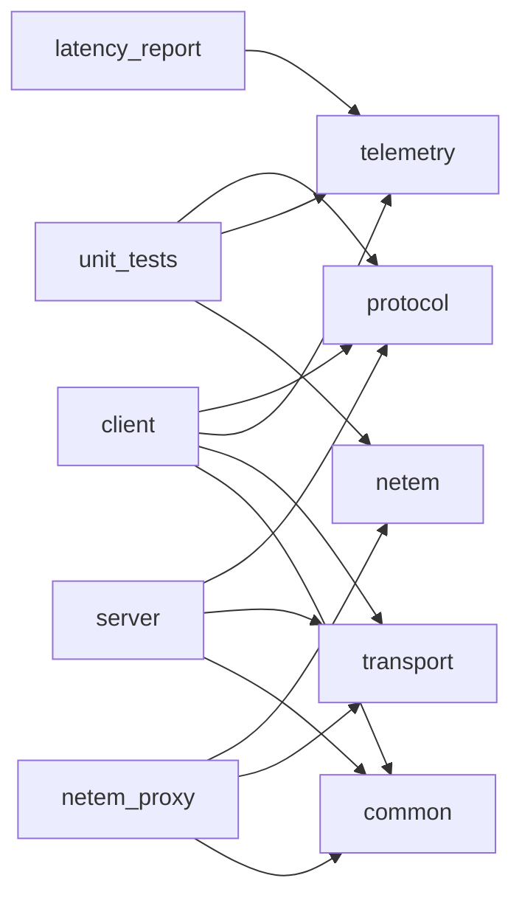

# Практическая работа №2: измерение RTT и анализ качества UDP-соединения

Подсистема телеметрии UDP-протокола на C++17. Клиент отправляет `PING`, сервер отвечает
`PONG`. Клиент измеряет RTT, сглаженный RTT (SRTT), джиттер и долю потерь, а запоздалые,
повторные, чужие и некорректные ответы отделяет от измерений.
Основа — шаблон [`pr2-latency-template`](https://gitverse.ru/univ-mirea-iit/course-multiplayer/content/master/pr2-latency-template).
Работа продолжает [ПР №1](https://github.com/5hleev/udp-game-protocol) (команды `MOVEMENT`/`SHOOT`).

**Выполнил:** Шлеев Максим Евгеньевич, ИКБО-21-23.

## Документация

| Документ | Содержание |
|---|---|
| [docs/Protocol_Specification.md](docs/Protocol_Specification.md) | формат PING/PONG, проверки, причины отбрасывания, диаграмма состояний inFlight |
| [docs/Experiment_Config.md](docs/Experiment_Config.md) | окружение, параметры эмулятора по сериям, seed, как воспроизвести |
| [docs/Latency_Report.md](docs/Latency_Report.md) | таблица метрик, графики, анализ, выводы |
| [docs/latency_samples.csv](docs/latency_samples.csv) | журнал всех измерений |
| [docs/latency_summary.csv](docs/latency_summary.csv) | метрики по сериям (вывод `latency_report`) |
| [docs/logs/](docs/logs) | журналы сервера, клиента и эмулятора за прогон |

## Архитектура

Сетевой ввод-вывод, сериализация и расчёт метрик разнесены по отдельным библиотекам.
Каждая зависит только от того, что ей действительно нужно:

```
protocol/   packet.hpp/.cpp         формат пакетов, WriteU16/ReadU64..., Parse*/Serialize*  (без сети и часов)
telemetry/  telemetry.hpp/.cpp      inFlight, RTT/SRTT/джиттер, статусы ответов             (без сети; время - аргумент)
            sample_log.hpp/.cpp     строка CSV-журнала: формат и разбор с проверкой
            series_stats.hpp/.cpp   min/max/mean/median/p95, джиттер, loss rate серии
transport/  udp_socket.hpp/.cpp     UDP-сокет Winsock/POSIX, select()                        (не знает формата пакетов)
common/     clock, logger, cli      steady_clock, журнал, разбор аргументов
netem/      link_emulator.hpp/.cpp  модель канала: задержка, джиттер, потери... с seed       (чистая логика)
            netem_main.cpp          UDP-прокси - эмулятор сети вместо Clumsy
server/     server_main.cpp         склейка: transport -> protocol -> ответ PONG
client/     client_main.cpp         склейка: transport -> protocol -> telemetry -> CSV
tools/      latency_report.cpp      метрики по CSV -> таблица и latency_summary.csv
            plot_latency.py         графики в docs/graphs
            run_experiments.ps1     прогон всех серий
tests/      Catch2: protocol, telemetry, sample_log, series_stats, link_emulator
```



`telemetry` не читает часы сам: время передаётся параметром `nowUs`. Поэтому тайм-ауты,
`late_response` и `duplicate_response` проверяются в тестах детерминированно, без сети и
ожидания.

## Сборка

Нужны CMake ≥ 3.16 и компилятор C++17. Catch2 v3.5.2 скачивается через FetchContent.

**Windows (Visual Studio 2022):** запустить `build.bat`. Скрипт находит Visual Studio,
собирает проект через Ninja и запускает тесты.

**Любая ОС:**

```sh
cmake -S . -B build -DCMAKE_BUILD_TYPE=Release
cmake --build build
ctest --test-dir build --output-on-failure
```

## Запуск

```sh
build\server.exe                                   # порт 27015, журнал server.log
build\client.exe --experiment baseline --count 50 --interval 500
build\client.exe --experiment check --send-invalid # + проверка валидации на сервере
```

Параметры клиента: `--host 127.0.0.1 --port 27015 --experiment ID --count 50 --interval 500
--timeout 1000 --drain 1500 --csv docs/latency_samples.csv --log FILE --seq-start N
--send-invalid --verbose`. Все значения проверяются; при ошибке клиент печатает причину
и завершается с кодом 2.

Через эмулятор сети (задержка 100 ± 50 мс и 5 % потерь на пути клиент → сервер):

```sh
build\server.exe
build\netem_proxy.exe --listen 27016 --server 127.0.0.1:27015 --up "delay=100,jitter=50,loss=5" --seed 1006
build\client.exe --experiment combined --port 27016 --count 100 --interval 500
```

### Полный эксперимент

```powershell
powershell -ExecutionPolicy Bypass -File tools\run_experiments.ps1   # 7 серий x 100 PING, ~7 минут
python tools\plot_latency.py                                         # графики (нужен matplotlib)
```

### Пример вывода клиента

```
Серия 'combined': 100 PING на 127.0.0.1:27016, интервал 500 мс, тайм-аут 1000 мс, начальный seq=53208
Серия 'combined': отправлено 100, получено 91, тайм-аутов 9 (loss 9.000 %)
  RTT, мс: min 51.215 / mean 99.322 / median 97.146 / max 150.609; SRTT 98.286; jitter 33.764
  ответы: late 0, duplicate 0, unknown 0, некорректных датаграмм 0
  Telemetry (онлайн): SRTT 98.286, jitter 33.764, received 91, timeouts 9
```

Строка `Telemetry (онлайн)` — перекрёстная проверка. SRTT и джиттер, которые класс `Telemetry`
обновлял по ходу серии, должны совпасть со значениями, пересчитанными по журналу
(`series_stats`).

## Работа с Git

- `main` — импортированный шаблон;
- `feature/latency-measurement` — реализация, документация и результаты эксперимента;
  оформлена Pull Request'ом в `main`, задачи разбиты на issues.
