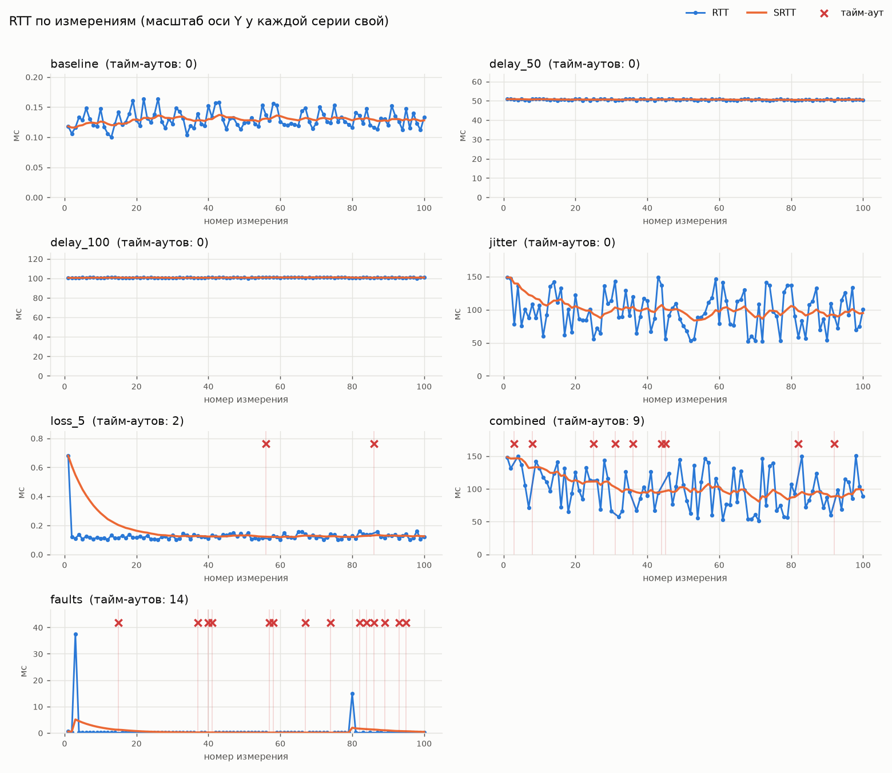
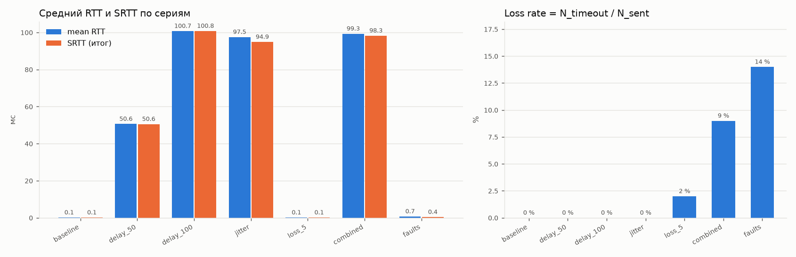
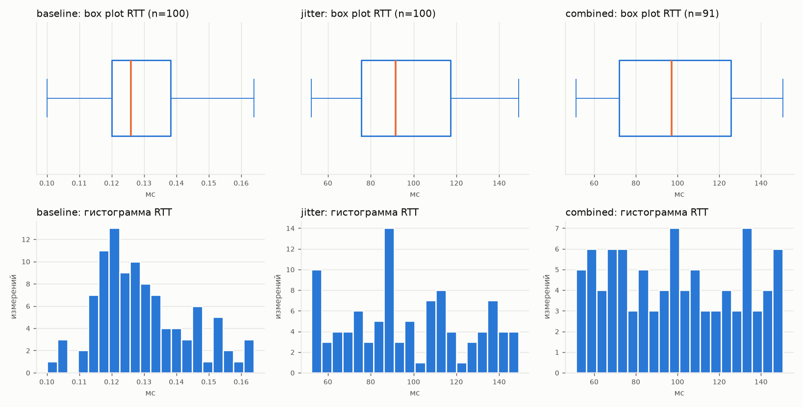

# Отчёт по измерению RTT

**Выполнил:** Шлеев Максим Евгеньевич, ИКБО-21-23. Работа выполнена индивидуально.

## Методика

1. Клиент (`client/`) отправляет серию из 100 PING с постоянным интервалом 500 мс. В каждом
   PING лежит `clientSendTimeUs` — время отправки по `steady_clock`. Перед отправкой
   измерение регистрируется в ограниченном окне `inFlight` (`Telemetry::OnPingSent`).
2. Сервер (`server/`) отвечает PONG. В ответе — эхо метки клиента и свои метки
   `serverReceiveTimeUs`/`serverSendTimeUs`. Серверные метки служат только для диагностики,
   так как часы не синхронизированы.
3. Сразу после `recvfrom()` клиент снимает время приёма и передаёт PONG в
   `Telemetry::OnPong`. Там вычисляется `RTT = t_recv − t_send` (только по часам клиента),
   обновляется `SRTT = 0.875·SRTT + 0.125·RTT` и назначается статус ответа.
4. Через 1000 мс без ответа `ExpireOverdue` переводит измерение в `timeout`. Ответ, пришедший
   позже, получает статус `late_response`. Повторный ответ — `duplicate_response`. Ответ с
   неизвестным номером или чужой эхо-меткой — `unknown_response`. Повторных отправок нет,
   они появятся в ПР №3.
5. Каждое измерение и каждый ошибочный ответ записываются в `docs/latency_samples.csv`.
   Утилита `latency_report` пересчитывает по журналу метрики каждой серии, тем же модулем
   `telemetry/series_stats`, что покрыт тестами. Скрипт `tools/plot_latency.py` строит графики.
6. Условия сети задаёт UDP-прокси `netem_proxy` с фиксированным seed. Параметры серий,
   окружение и причины отказа от Clumsy описаны в [Experiment_Config.md](Experiment_Config.md).

Формулы:

- джиттер `J = Σ|RTT_i − RTT_{i−1}| / (n − 1)` по полученным RTT в порядке номеров измерений;
- потери `Loss Rate = N_timeout / N_sent · 100 %`.

Измерение, ответ на которое пришёл после тайм-аута, считается потерянным: для протокола
реального времени ответ через 1,5 с бесполезен.

## Результаты

Источник: `docs/latency_summary.csv` (вывод `build\latency_report.exe`). Из 720 строк журнала
не отклонена ни одна.

| Серия | Отправлено | Получено | Тайм-ауты | Min RTT, мс | Avg RTT, мс | Median, мс | Max RTT, мс | Jitter, мс | Loss Rate, % |
|---|---:|---:|---:|---:|---:|---:|---:|---:|---:|
| baseline | 100 | 100 | 0 | 0.100 | 0.130 | 0.126 | 0.164 | 0.015 | 0.0 |
| delay_50 | 100 | 100 | 0 | 50.122 | 50.622 | 50.604 | 51.113 | 0.378 | 0.0 |
| delay_100 | 100 | 100 | 0 | 100.125 | 100.740 | 100.845 | 101.133 | 0.350 | 0.0 |
| jitter | 100 | 100 | 0 | 52.292 | 97.515 | 91.638 | 149.059 | 29.979 | 0.0 |
| loss_5 | 100 | 98 | 2 | 0.100 | 0.129 | 0.120 | 0.680 | 0.023 | 2.0 |
| combined | 100 | 91 | 9 | 51.215 | 99.322 | 97.146 | 150.609 | 33.764 | 9.0 |
| faults* | 100 | 86 | 14 | 0.097 | 0.734 | 0.118 | 37.400 | 1.251 | 14.0 |

Дополнительные метрики:

| Серия | SRTT (итог), мс | P95, мс | σ RTT, мс | late / duplicate / unknown |
|---|---:|---:|---:|---|
| baseline | 0.128 | 0.156 | 0.014 | 0 / 0 / 0 |
| delay_50 | 50.558 | 51.082 | 0.317 | 0 / 0 / 0 |
| delay_100 | 100.789 | 101.102 | 0.352 | 0 / 0 / 0 |
| jitter | 94.886 | 141.948 | 28.107 | 0 / 0 / 0 |
| loss_5 | 0.125 | 0.155 | 0.058 | 0 / 0 / 0 |
| combined | 98.286 | 146.385 | 29.736 | 0 / 0 / 0 |
| faults* | 0.401 | 0.176 | 4.306 | 7 / 5 / 8 |

\* `faults` — дополнительная серия для проверки ошибочных ответов, в задании её нет.

Во всех сериях онлайн-оценки `Telemetry` (SRTT и джиттер, которые обновлялись по ходу
приёма) совпали с пересчётом по журналу до третьего знака (строка `Telemetry (онлайн)` в
`docs/logs/client_*.log`).

## Графики

### RTT по измерениям, тайм-ауты отмечены крестиками

### Средний RTT, SRTT и доля потерь

Миллисекунды и проценты — разные величины, поэтому они на двух панелях, а не на двух осях
одного графика.

### Распределение RTT: baseline, jitter, combined

## Анализ

**Baseline.** RTT через loopback и прокси — 0.10–0.16 мс, медиана 0.126 мс. Джиттер
0.015 мс. Эта величина — собственная стоимость измерительного тракта: два прохода через
прокси, системные вызовы и планировщик. Она на три порядка меньше любой эмулируемой
задержки и на результаты серий практически не влияет.

**Задержка (delay_50, delay_100).** Средний RTT вырос на 50.49 и 100.61 мс относительно
baseline. Излишек около 0,5 мс — дискретность таймера Windows: даже с `timeBeginPeriod(1)`
`select()` просыпается с точностью около 1 мс. Разброс внутри серий ±0,5 мс, джиттер
0.35–0.38 мс. Постоянная задержка сдвигает RTT, но почти не меняет джиттер, а SRTT
совпадает со средним (50.56 и 100.79 мс).

**Джиттер.** Задержка равномерна на [50; 150] мс. Теория для U(a, b) с шириной w = 100 мс
даёт среднее 100 мс, σ = w/√12 = 28.9 мс и ожидаемый джиттер E|X − Y| = w/3 = 33.3 мс.
Измерено: среднее 97.5 мс, σ = 28.1 мс, J = 30.0 мс, min/max = 52.3/149.1 мс. Гистограмма
равномерная, без выраженного пика, как и должно быть. SRTT колеблется в диапазоне
84–116 мс, тогда как сам RTT — 52–149 мс. Это и есть назначение сглаживания: оценка
следует за средним уровнем, а не за каждым скачком. Ошибка |RTT − SRTT| в среднем 22 мс.
Поэтому для тайм-аута одного SRTT недостаточно, нужна ещё оценка разброса (RTTVAR в
RFC 6298, задача ПР №3).

**Потери (loss_5, combined).** Фактически потеряно 2 % и 9 % при заданных 5 %. Это не ошибка
эмулятора, а статистика малой выборки. При n = 100 и p = 0.05 число потерь распределено
биномиально со стандартным отклонением √(100·0.05·0.95) ≈ 2.2 пакета.
P(X ≤ 2) = 0.12 и P(X ≥ 9) = 0.06, то есть оба исхода вполне обычны. 95-процентные
интервалы Уилсона по наблюдениям — 0.6–7.0 % для `loss_5` и 4.8–16.2 % для `combined` —
оба содержат заданные 5 %. Эмулятор сам
подтверждает число потерянных пакетов (`Итого C->S: потеряно 2 / 9` в `netem_*.log`), а
число тайм-аутов у клиента совпало с ним точно. Значит, все пропуски — потери в канале,
а не ошибки клиента. Для оценки доли потерь с точностью ±1 % нужно около 2000 PING в серии.
Потери не сдвигают RTT: в `loss_5` RTT такой же, как в baseline. На джиттер они влияют лишь
тем, что соседними становятся измерения, разделённые пропуском.

**Combined.** Наложение задержки, джиттера и потерь дало среднее 99.3 мс, J = 33.8 мс и 9 %
потерь. Распределение RTT такое же равномерное, как в `jitter` (box plot почти совпадает).
Задержка и потери независимы, и метрики складываются без взаимного влияния.

**Ошибочные ответы (faults).** Эмулятор продублировал 5 ответов, задержал 7 на 1500 мс,
испортил 10 и добавил 4 копии с чужим номером. Клиент зафиксировал:

- 5 `duplicate_response` — по числу дублей. RTT и SRTT дубли не изменили;
- 7 `late_response` с RTT ≈ 1500 мс. Каждый из этих семи PING сначала получил `timeout`
  (через 1000 мс), затем пришёл ответ;
- 8 `unknown_response`: 4 копии с изменённым номером и 4 испорченных ответа, у которых
  повреждены `sequenceNumber` или `clientSendTimeUs`, поэтому эхо не совпало с inFlight;
- 3 датаграммы отброшены при разборе: два раза `serverSendTimeUs < serverReceiveTimeUs`
  и один раз неверная `protocolVersion`;
- итого 14 тайм-аутов = 7 задержанных + 4 нераспознанных + 3 отброшенных. Ещё 3 порчи
  пришлись на серверные метки времени и не были обнаружены: в формате ПР №2 нет
  контрольной суммы. На RTT это не влияет, так как он считается только по часам клиента.

В этой же серии видны два выброса RTT: 37.4 мс (№3) и 14.9 мс (№80). Канал при этом был
прозрачен в обе стороны, а порча и пики задержки в `netem_faults.log` пришлись на другие
пакеты. Это вытеснение процесса планировщиком Windows. Выброс №3 поднял SRTT с 0.56 до
5.1 мс, и оценка возвращалась к базовому уровню около 20 измерений
(0.875^20 ≈ 0.07). Похожий эффект в начале `loss_5`: первое измерение 0.68 мс — «холодный
старт» сокета и кэшей. Отсюда практическое правило: первое RTT, инициализирующее SRTT,
стоит отбрасывать или брать минимум из первых нескольких.

**Валидация на сервере.** В серии `baseline` клиент отправил 10 некорректных датаграмм.
Сервер отбросил все, с причиной в `docs/logs/server.log`: короче заголовка ×2, payloadSize
не совпадает с длиной ×3, неизвестный тип, неверная версия, PONG от клиента, 600 байт,
MOVEMENT с NaN. Ни на одну он не ответил и работу не прервал. Корректные `MOVEMENT` и
`SHOOT` приняты. За прогон сервер обработал 701 датаграмму и ответил на 689 PING: 700
минус 11 потерянных эмулятором по пути C→S.

**Выбор тайм-аута.** 1000 мс — значение из задания. Максимальный RTT во всех сериях — 150.6 мс,
поэтому ложных тайм-аутов нет: все 25 тайм-аутов подтверждены журналом эмулятора. По
RFC 6298 (RTO = SRTT + 4·RTTVAR) для `combined` получилось бы около 200–220 мс. Это быстрее
обнаруживало бы потери, но требует адаптивного RTTVAR, а значит относится к ПР №3.

## Вывод

Подсистема телеметрии измеряет RTT, SRTT, джиттер и долю потерь, а эмулируемые условия
восстанавливаются по метрикам с хорошей точностью:

- задержка — с точностью около 0,5 мс;
- джиттер — с точностью около 10 % от теоретического значения;
- потери — точно, если сверять с журналом эмулятора.

Запоздалые, повторные, чужие и повреждённые ответы распознаются и не искажают статистику.

Модульная архитектура позволила покрыть логику 59 тестами без сети: `protocol` не знает о
сокетах, `telemetry` получает время параметром, `netem` детерминирован по seed. Эксперимент
воспроизводим: повторный прогон `loss_5` с тем же seed потерял те же измерения №56 и №86.
