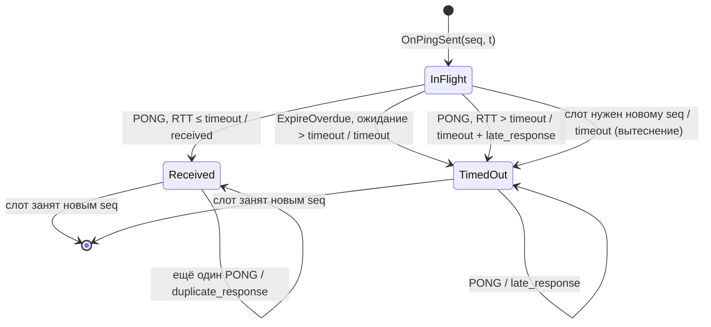

# Спецификация протокола измерения RTT

Протокол продолжает ПР №1 (команды `MOVEMENT`/`SHOOT`) и добавляет пару `PING`/`PONG`
для измерения времени приёма-передачи. Транспорт — UDP/IPv4, сервер по умолчанию
слушает порт **27015**, эмулятор сети `netem_proxy` — порт **27016**.

Код: `protocol/packet.hpp`, `protocol/packet.cpp`. Тесты: `tests/test_protocol.cpp`.

## Формат заголовка

Каждая датаграмма начинается с заголовка длиной 7 байт. Все многобайтовые поля передаются
в **сетевом порядке байт (big-endian)**. Выравнивания и заполнителей нет.

| Смещение | Поле | Тип | Байты | Описание |
|---:|---|---|---:|---|
| 0 | packetType | uint8_t | 1 | `1` PING, `2` PONG, `3` MOVEMENT, `4` SHOOT |
| 1 | sequenceNumber | uint16_t | 2 | идентификатор измерения/команды, по модулю 2^16 |
| 3 | payloadSize | uint16_t | 2 | размер полезной нагрузки в байтах, обязан равняться `длина датаграммы − 7` |
| 5 | protocolVersion | uint16_t | 2 | версия формата, сейчас `1` |
| 7 | payload | — | payloadSize | зависит от packetType |

Максимальный размер датаграммы — 512 байт (с запасом меньше MTU, фрагментации IP нет).

Сериализация выполняется функциями `WriteU8/WriteU16/WriteU32/WriteU64` и
`ReadU8/ReadU16/ReadU32/ReadU64`. Структуры **не копируются в буфер целиком** (`memcpy(&struct)`):
раскладка struct зависит от выравнивания компилятора и порядка байт процессора. Каждая
функция чтения сначала проверяет, что до конца буфера осталось нужное число байт, и только
потом читает; при нехватке возвращает `std::nullopt` и не сдвигает курсор.

## PING (клиент → сервер)

| Смещение | Поле | Тип | Описание |
|---:|---|---|---|
| 7 | clientSendTimeUs | uint64_t | момент отправки по монотонным часам клиента, микросекунды |

`payloadSize = 8`, полный размер — **15 байт**. Пример (`seq = 0x0102`, время `0x1122334455667788`):

```
01 | 01 02 | 00 08 | 00 01 | 11 22 33 44 55 66 77 88
```

Время берётся из `std::chrono::steady_clock` (`common::NowUs()`). Это монотонные часы:
их не переводит NTP или пользователь, но начало отсчёта произвольно, поэтому значение
имеет смысл только внутри процесса клиента.

## PONG (сервер → клиент)

| Смещение | Поле | Тип | Описание |
|---:|---|---|---|
| 7 | clientSendTimeUs | uint64_t | копия поля из PING без изменений |
| 15 | serverReceiveTimeUs | uint64_t | момент приёма PING по монотонным часам сервера, мкс |
| 23 | serverSendTimeUs | uint64_t | момент отправки PONG по часам сервера, мкс |

`payloadSize = 24`, полный размер — **31 байт**. `sequenceNumber` PONG равен номеру PING.

### Как PONG используется при расчёте RTT

Часы клиента и сервера **не синхронизированы**, поэтому:

- RTT считается **только по часам клиента**:
  `RTT = t_receive_client − t_send_client`, где `t_send_client` — время из записи inFlight,
  а `t_receive_client` — значение `NowUs()` сразу после `recvfrom()` (до разбора пакета);
- `clientSendTimeUs` из PONG сверяется с временем отправки в записи inFlight. Несовпадение
  означает, что ответ относится к другому измерению с тем же номером (номер пошёл на
  второй круг или пакет подделан/испорчен). Такой ответ — `unknown_response`;
- `serverSendTimeUs − serverReceiveTimeUs` — время обработки на сервере. Оно используется
  только для диагностики (пишется в подробный лог клиента), в RTT не вычитается.

Сглаженная оценка: `SRTT = 0.875 · SRTT + 0.125 · RTT` (α = 1/8, как в RFC 6298), первое
успешное RTT инициализирует SRTT.

## MOVEMENT и SHOOT (из ПР №1)

| Тип | payloadSize | Поля |
|---|---:|---|
| MOVEMENT (3) | 12 | `x`, `y`, `z` — float32 IEEE-754, каждое передаётся как uint32 big-endian |
| SHOOT (4) | 1 | `weaponId` — uint8 |

Сервер принимает их и пишет команду в журнал. Координата NaN/∞ — ошибка `BadPayloadValue`.

## Причины отбрасывания пакета

`ParseHeader` и `Parse*` никогда не бросают исключений и не читают за пределами буфера.
При ошибке возвращается `std::nullopt` и код `ParseError`. Получатель отбрасывает
датаграмму, пишет строку `ОТБРОШЕНА ...` с причиной в журнал и продолжает работу.

| Проверка (в порядке выполнения) | ParseError | Текст в журнале |
|---|---|---|
| длина < 7 байт или нулевой указатель | `TooShort` | датаграмма короче заголовка |
| длина > 512 байт | `TooLarge` | датаграмма больше максимального размера |
| packetType ∉ {1, 2, 3, 4} | `UnknownType` | неизвестный packetType |
| protocolVersion ≠ 1 | `BadVersion` | неподдерживаемая protocolVersion |
| payloadSize ≠ длина − 7 | `PayloadSizeMismatch` | payloadSize не совпадает с длиной датаграммы |
| тип не тот, что ожидает парсер (например, PONG пришёл серверу) | `UnexpectedType` | неожиданный packetType |
| payloadSize не равен размеру для типа (PING 8, PONG 24, …) | `BadPayloadLength` | payloadSize не соответствует типу пакета |
| значение поля недопустимо: NaN в MOVEMENT, `serverSendTimeUs < serverReceiveTimeUs` в PONG | `BadPayloadValue` | недопустимое значение в payload |

Дополнительно клиент отбрасывает датаграммы не от адреса сервера, которому отправлял PING.

Проверка на практике: `client --send-invalid` отправляет серверу 10 некорректных датаграмм
(пустую, обрезанные, с неверными типом, версией и размером, PONG, 600 байт, MOVEMENT с NaN).
Сервер отбрасывает каждую с причиной в журнале и ни на одну не отвечает
(см. `docs/logs/server.log`).

> В формате ПР №2 нет контрольной суммы (в ПР №1 был CRC32). Поэтому порча байта внутри
> payload, например в `serverReceiveTimeUs`, не обнаруживается. Порча `clientSendTimeUs` или
> `sequenceNumber` ловится сверкой эха с inFlight. Это проверено серией `faults`.

## Состояния измерения (inFlight)

Клиент хранит измерения в ограниченном контейнере `inFlight` (`telemetry::Telemetry`).
Это кольцо из `capacity = 256` слотов, запись номера `seq` лежит в слоте `seq % 256`.
Запись содержит: номер `sequence`, порядковый номер `sample`, время отправки `sentAtUs`,
идентификатор серии `experimentId`, состояние и число попыток `attempts`. В ПР №2 повторов
нет, поэтому `attempts = 1`.



PONG с номером, которого нет в inFlight, или с чужим `clientSendTimeUs` — `unknown_response`.
Состояние записей при этом не меняется.

| Статус в CSV | Когда | Влияние на метрики |
|---|---|---|
| `received` | PONG пришёл не позже тайм-аута | RTT, SRTT, джиттер |
| `timeout` | PONG не пришёл за тайм-аут | N_timeout в доле потерь |
| `late_response` | PONG пришёл после тайм-аута | только событие; измерение уже засчитано как `timeout` |
| `duplicate_response` | повторный PONG на завершённое измерение | только событие |
| `unknown_response` | номер не найден в inFlight или эхо не совпало | только событие |

**Почему окно ограничено.** Неограниченный `unordered_map` растёт при потерях бесконечно.
Кольцо фиксированного размера даёт O(1) на поиск и ограниченную память. Ёмкость не
превышает 2^15: тогда номера `seq` и `seq + 2^15` никогда не находятся в окне одновременно
и ответы на них не путаются. При интервале 500 мс запись живёт в слоте 128 с, что намного
больше тайм-аута. Если слот всё же занят незавершённым измерением, оно засчитывается как
`timeout` и не теряется из статистики.

**Тайм-аут** — 1000 мс (по заданию). Он с запасом больше максимального RTT во всех сериях
(около 150 мс в `jitter`/`combined`) и при этом меньше трёх интервалов отправки.
Граница строгая: RTT ровно 1000 мс ещё `received`.

## Журнал измерений `docs/latency_samples.csv`

```
experiment_id;sample;sequence;sent_at_ms;rtt_ms;srtt_ms;status
baseline;1;16312;0.000;0.118;0.118;received
loss_5;56;58385;27500.754;;;timeout
faults;37;37996;18000.969;1500.881;;late_response
faults;1;37960;0.000;5.588;;duplicate_response
faults;;5246;;;;unknown_response
```

- `sent_at_ms` — время отправки от начала серии по часам клиента;
- `received` и `timeout` — по одной строке на каждый отправленный PING. Для `late_response`
  и `duplicate_response` в `rtt_ms` записано фактическое время ответа (справочно), `srtt_ms`
  пуст. У `unknown_response` номер измерения неизвестен, поэтому `sample` и `sent_at_ms` пусты;
- строки идут в порядке событий: строка `timeout` появляется через 1 с после отправки,
  то есть позже следующих `received`. Метрики считаются в порядке `sample`.
